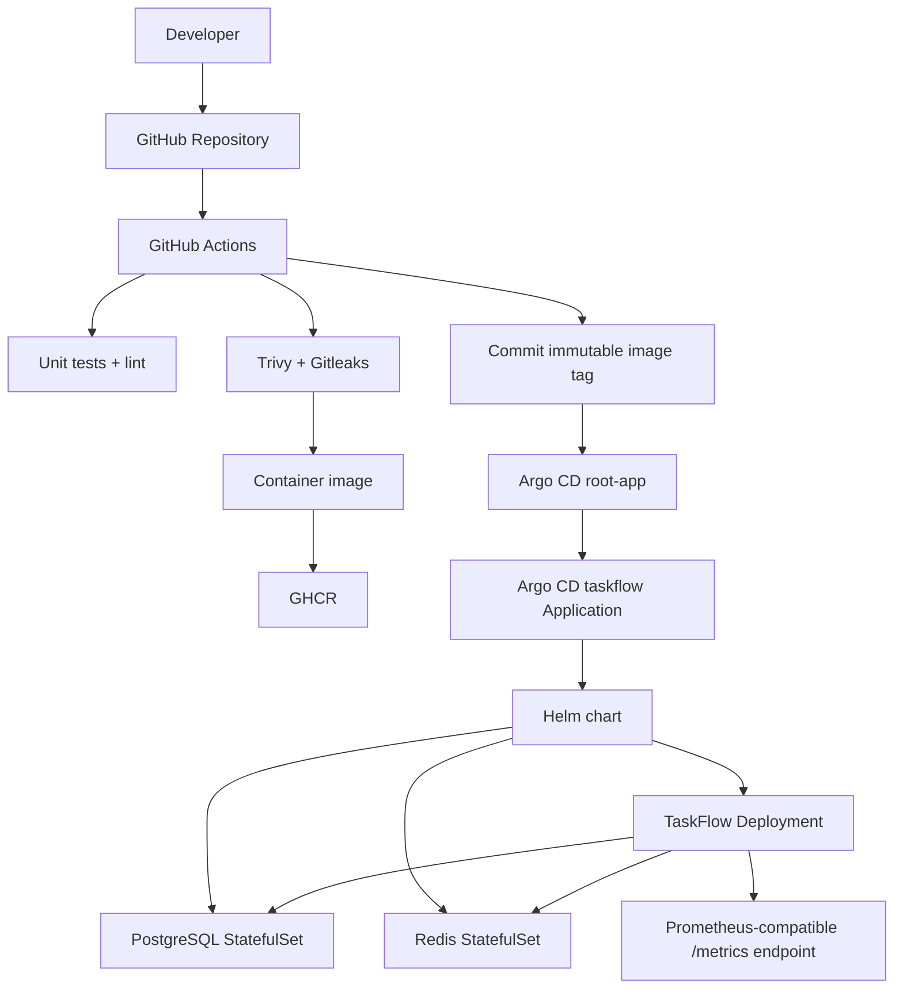

# TaskFlow Detailed Learning Documentation

## 1. What you are building

TaskFlow is deliberately small at the application layer and broad at the platform layer. The goal is to demonstrate that you can take a service from source code to a repeatable, observable Kubernetes deployment while keeping infrastructure and deployment state declarative.

The learning sequence is:

**source → test → container → registry → Kubernetes → GitOps → secrets → observability → reliability**

The application is only the workload. The portfolio evidence comes from everything surrounding it.

---

## 2. Where the project currently stands

The infrastructure work completed before adding this application includes:

| Area | What has been accomplished |
|---|---|
| Kubernetes | A three-node k3d/k3s cluster is available and nodes are Ready. |
| OpenTofu | OpenTofu is being used as `terraform`, with offline provider installation. |
| kubectl provider | A locally built `gavinbunney/kubectl` provider is available through the OpenTofu development override. |
| Sealed Secrets | Official Sealed Secrets controller resources were deployed successfully and the controller secret/certificate was read by OpenTofu. |
| Argo CD | Argo CD was successfully installed with OpenTofu. |
| Argo root Application | `root-app` exists in the `argocd` namespace. |
| GitOps hand-off | The root Application is intended to read the `app-of-apps` directory from `https://github.com/FET0/taskflow-app`. |

This repository supplies the missing workload side of the original design.

---

## 3. The architecture



### Why this architecture matters

A DevOps engineer should be able to explain not only what runs, but how a change travels through the system.

A code change becomes an image. A successful pipeline promotes an immutable image reference into Git. Argo CD notices the Git change and reconciles Kubernetes. Kubernetes rolls the workload. Health probes control traffic. PostgreSQL provides durable application state. Redis provides caching and a fast dependency. Metrics provide the raw material for alerting and SLOs.

---

# Part I — Application engineering

## 4. Why Node.js + Express

The API has intentionally little domain complexity. It exposes CRUD operations for tasks:

- `POST /api/v1/tasks`
- `GET /api/v1/tasks`
- `GET /api/v1/tasks/:id`
- `PATCH /api/v1/tasks/:id`
- `DELETE /api/v1/tasks/:id`

Operational endpoints are separated from the business API:

- `/healthz` — process health
- `/readyz` — PostgreSQL and Redis dependency readiness
- `/metrics` — Prometheus-compatible metrics

The distinction between liveness and readiness is an important Kubernetes concept. A live process can exist while its dependencies are unavailable. Readiness prevents traffic from being sent to an instance that cannot serve real requests.

## 5. PostgreSQL

PostgreSQL is the system of record. The repository contains a first migration:

`migrations/001_init.sql`

The application table is intentionally simple:

```text
tasks
 ├── id
 ├── title
 ├── description
 ├── status
 ├── created_at
 └── updated_at
```

The Helm chart runs the migration as an init container before the application container starts.

### Learning exercise

Add a second migration for task priority and due dates. Learn why migrations must be forward-only and why application startup should not silently rewrite production schemas.

---

## 6. Redis

Redis is used as a cache for paginated task lists. The cache key contains status, page, and page size.

The current implementation clears the cache whenever data changes. This is simple and safe for a learning project. A more advanced implementation would invalidate only affected keys.

### Learning exercise

Add cache hit/miss metrics. Compare latency for cached and uncached requests with a load generator.

---

# Part II — Containerisation

## 7. Dockerfile design

The Dockerfile uses a two-stage build:

1. dependency stage installs production dependencies;
2. runtime stage receives only what is required to run the API.

The container:

- uses a non-root user;
- exposes only port 3000;
- provides a Docker health check;
- uses a read-only root filesystem at Kubernetes runtime;
- drops Linux capabilities.

### Learning exercise

Run:

```bash
docker build -t taskflow-api:local .
docker run --rm -p 3000:3000 taskflow-api:local
```

Then explain why the container can write `/tmp` even when the root filesystem is read-only in Kubernetes. The answer is the `emptyDir` volume mounted at `/tmp`.

---

# Part III — Kubernetes

## 8. Helm

The chart is in `deploy/chart`.

Instead of hard-coding all environment-specific settings into manifests, Helm values define:

- image repository and tag;
- replica count;
- resource requests and limits;
- service type and port;
- PostgreSQL and Redis images/storage;
- secret name;
- optional ingress and ServiceMonitor.

### Important Helm concepts to learn

**Values** are inputs.

**Templates** turn inputs into Kubernetes manifests.

**Releases** represent a deployed chart instance.

The chart is intentionally simple enough to understand line by line.

---

## 9. Resource requests and limits

The application declares CPU and memory requests/limits. Requests influence scheduling; limits constrain resource consumption.

A strong next step is to benchmark the application and replace guessed values with measured ones.

Record:

```text
steady-state CPU
steady-state memory
peak CPU
peak memory
startup time
95th/99th percentile latency
```

Then explain how you derived the Kubernetes values.

---

## 10. Probes

There are three layers in the TaskFlow deployment:

### Startup probe

Allows the application time to start without being killed by liveness checks too early.

### Readiness probe

Checks `/readyz`, which verifies PostgreSQL and Redis connectivity.

### Liveness probe

Checks `/healthz`, which answers whether the application process is alive.

This separation is an important interview topic.

---

# Part IV — Secrets

## 11. Why secrets are not stored in values.yaml

The database password and Redis password must not appear in normal Git history.

The chart references an existing Kubernetes Secret named:

`taskflow-secrets`

NetworkPolicy is included as an optional hardening layer and is disabled by default because enforcement details can vary with the cluster CNI. Enable it only after validating your cluster's policy behavior.

The Secret is created from an encrypted SealedSecret manifest.

The helper script:

`scripts/seal-secret.sh`

performs the local secret creation and sealing workflow.

## 12. Your first secure deployment

Use:

```bash
export POSTGRES_USER=taskflow
export POSTGRES_PASSWORD='long-random-password'
export POSTGRES_DB=taskflow
export REDIS_PASSWORD='another-long-random-password'
./scripts/seal-secret.sh
```

The script obtains the Sealed Secrets public certificate from the current cluster and encrypts a generated Kubernetes Secret.

Commit only the resulting encrypted YAML.

### Important security principle

Encryption is performed for the cluster. The SealedSecret ciphertext is safe to store in Git under the normal Sealed Secrets trust model, but the private sealing key must remain protected inside the cluster.

### Learning exercise

Destroy and recreate the application namespace while preserving the Sealed Secrets controller. Observe whether the encrypted secret can be recreated from Git.

---

# Part V — Argo CD GitOps

## 13. App-of-Apps

The current OpenTofu-managed root Application reads:

`app-of-apps/`

That directory contains:

`taskflow.yaml`

The root Application creates the child `taskflow` Application, which points to:

`deploy/chart`

This creates a GitOps chain:

```text
Terraform/OpenTofu
        ↓
   root-app
        ↓
 taskflow Application
        ↓
     Helm chart
        ↓
 Kubernetes resources
```

The important idea is that OpenTofu bootstraps Argo CD; Argo CD owns the application workload afterward.

## 14. Why this matters

Without GitOps, an engineer may change a live object with `kubectl` and leave Git unaware of the change.

With GitOps:

1. Git describes the desired state.
2. Argo CD reads the desired state.
3. Argo CD compares it with the cluster.
4. Argo CD reconciles drift.

### Interview question

**What happens if someone manually scales the TaskFlow Deployment to five replicas?**

Because `selfHeal` is enabled, Argo CD should detect the drift and reconcile the workload back to the desired replica count defined by Git.

---

# Part VI — CI/CD

## 15. CI workflow

`.github/workflows/ci.yml` performs:

- dependency installation;
- unit tests;
- ESLint;
- Trivy filesystem scanning;
- Gitleaks scanning.

This is the first security gate.

## 16. Image promotion workflow

`.github/workflows/image.yml` performs:

```text
Git push
   ↓
Docker buildx
   ↓
GHCR
   ↓
Trivy image scan
   ↓
Cosign signature
   ↓
Git commit with image SHA
   ↓
Argo CD reconciliation
```

This makes the image reference immutable rather than relying permanently on a floating tag.

## 17. Why the SHA matters

A mutable tag such as `main` can point at different images over time.

An immutable reference such as:

```text
ghcr.io/fet0/taskflow-api:<git-sha>
```

lets you answer:

> Exactly which source revision is running in Kubernetes?

That traceability is one of the strongest portfolio signals in this project.

---

# Part VII — Observability

## 18. Metrics

TaskFlow exposes:

- total HTTP requests;
- HTTP request duration;
- default Node.js runtime/process metrics.

The endpoint is:

```text
GET /metrics
```

The chart contains an optional ServiceMonitor resource. It is disabled by default because the cluster must have a Prometheus Operator-compatible monitoring stack before that object is useful.

### Next phase

Install Prometheus and Grafana through GitOps.

Then:

1. enable `serviceMonitor.enabled`;
2. scrape `/metrics`;
3. build a dashboard;
4. define latency/error-rate alerts;
5. add Alertmanager.

---

# Part VIII — Reliability engineering

## 19. Suggested SLOs

Start with a simple availability SLO:

**99.5% of valid API requests return successfully over 30 days.**

Then add a latency SLO:

**95% of successful API requests complete in under 500 ms.**

The exact targets should be justified by measurement rather than chosen arbitrarily.

## 20. Error budget thinking

For an availability SLO of 99.5%, the monthly error budget is approximately:

```text
0.5% of total eligible request time
```

Learn to use the budget to decide whether the next sprint should prioritize features or reliability work.

---

# Part IX — Failure injection

## 21. Practical chaos experiments

Before introducing LitmusChaos, perform small controlled failures manually in a disposable cluster.

### Experiment A — Kill an API pod

```bash
kubectl delete pod -n taskflow -l app.kubernetes.io/name=taskflow
```

Observe whether the Deployment replaces it automatically.

### Experiment B — Break Redis

Scale Redis to zero temporarily and watch `/readyz`.

### Experiment C — Delete the API Deployment

Argo CD should recreate the desired workload from Git.

### Experiment D — Introduce Git drift

Change the replica count manually and watch Argo CD self-heal.

Record:

```text
Detection time
Recovery time
User impact
Root cause
Control that restored service
Evidence from logs/metrics/events
```

---

# Part X — Troubleshooting lessons from the infrastructure phase

## 22. Offline OpenTofu providers

You had to distinguish between a provider source tree and a provider executable.

The important model is:

```text
provider source code
      ↓ go build
provider executable
      ↓ OpenTofu provider discovery
Terraform/OpenTofu resource support
```

The local `gavinbunney/kubectl` provider was built from the v1.19.0 source and exposed through an OpenTofu development override. Provider schema discovery then succeeded.

This is useful infrastructure troubleshooting experience because provider installation failures are often filesystem/layout/version problems rather than Terraform configuration errors.

## 23. Sealed Secrets multi-document YAML

The official Sealed Secrets controller YAML contained multiple Kubernetes documents.

A single `yamldecode(file(...))` cannot represent an entire multi-document YAML stream as multiple resources.

The successful approach was to split the stream into individual YAML documents and create one `kubectl_manifest` per file.

This is a valuable Kubernetes-manifest processing lesson.

## 24. Argo CD image-pull timeout

The first Argo CD deployment reached the Helm provider timeout even though the cluster later became healthy.

The useful diagnosis was to inspect Kubernetes events and pod state rather than assuming a failed Helm release. Slow image pulls on the RHPC environment were the dominant factor.

The timeout was then increased and the saved plan was regenerated before applying again.

The final Argo deployment completed successfully in roughly 46 seconds during the later apply.

---

# Part XI — Your learning workflow

## 25. The daily loop

Use the following loop for every change:

```text
1. Change Git
2. Run tests
3. Build/scan locally when useful
4. Commit
5. Push
6. Watch GitHub Actions
7. Watch Argo CD
8. Inspect Kubernetes events
9. Verify application behavior
10. Record what you learned
```

Do not make `kubectl apply` your normal application deployment mechanism. Use it for diagnostics and controlled experiments; let Argo CD own the application state.

---

# Part XII — Portfolio evidence

## 26. Screenshots worth capturing

Capture evidence of:

1. GitHub Actions green CI run.
2. GHCR package and immutable SHA tag.
3. Cosign signature verification.
4. Argo CD Application `Synced` + `Healthy`.
5. Two TaskFlow API replicas running.
6. PostgreSQL and Redis healthy.
7. `/metrics` output or Grafana dashboard.
8. Argo CD showing a successful GitOps sync.
9. A deliberate drift followed by Argo self-healing.

## 27. Resume bullet you can aim for

A strong final result can be described as:

> Built and operated a GitOps-driven Node.js task management platform on Kubernetes using OpenTofu, Helm and Argo CD, with Sealed Secrets, GitHub Actions security gates, immutable GHCR images, Cosign signing, PostgreSQL/Redis, health probes and Prometheus-compatible metrics.

Replace generic claims with measured results once you collect deployment time, request latency, recovery time, and availability data.

---

# Part XIII — Recommended next sprints

## Sprint 2 — Observability

Add Prometheus, Grafana and Alertmanager through Argo CD.

Deliver:

- API dashboard
- alert rules
- SLO recording rules
- error-rate and latency panels

## Sprint 3 — Supply-chain security

Add:

- SBOM generation
- provenance/attestations
- Cosign verification as a deployment gate
- admission policy using Kyverno or OPA Gatekeeper

## Sprint 4 — Production-grade delivery

Add:

- separate dev/prod environments;
- progressive delivery with Argo Rollouts;
- canary deployments;
- automated rollback;
- image promotion between environments.

## Sprint 5 — Reliability and chaos

Add:

- LitmusChaos or another controlled chaos tool;
- documented game days;
- measured MTTR;
- dependency failure tests.

## Sprint 6 — Cloud portability

Move the same application to a managed Kubernetes service and replace in-cluster PostgreSQL/Redis with managed equivalents.

The key learning objective is to preserve the GitOps contract while swapping the infrastructure underneath it.

---

# 28. Core interview topics to master

By the end of the project, you should be able to explain clearly:

- why containers should be immutable;
- why image tags should be immutable in production;
- Helm versus Kustomize;
- Terraform/OpenTofu versus Argo CD responsibilities;
- Kubernetes readiness versus liveness;
- StatefulSet versus Deployment;
- PVCs and storage classes;
- Kubernetes Secrets versus Sealed Secrets;
- GitOps reconciliation and drift;
- CI versus CD;
- SBOMs, image scanning and signing;
- resource requests versus limits;
- horizontal scaling of stateless services;
- caching consistency and invalidation;
- SLOs, SLIs and error budgets;
- incident response and rollback.

If you can demonstrate these topics using TaskFlow rather than only define them, the repository becomes a much stronger portfolio artifact.
